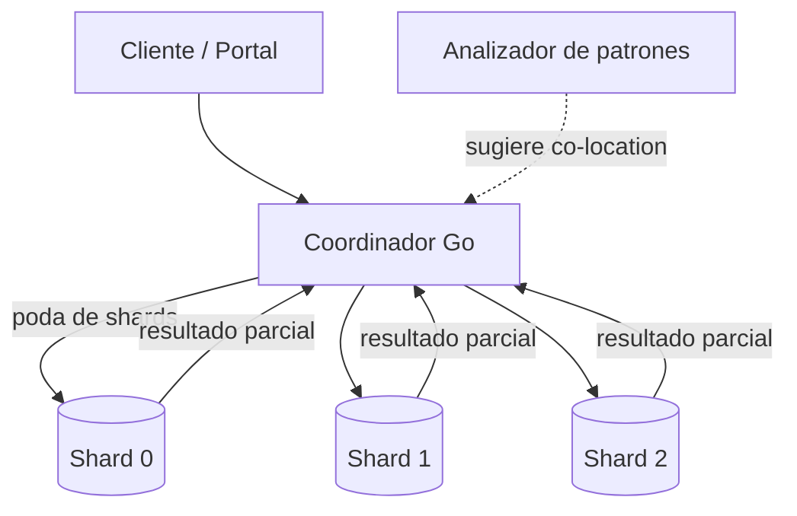

# shardlab

> Un experimento de aprendizaje: mini motor de consultas distribuido sobre
> PostgreSQL, con co-location de tablas decidida según el patrón de consultas.


**Esto no es un producto ni pretende reemplazar a Citus o Vitess.** Es un
laboratorio para entender, midiendo, cómo se combinan sharding, co-location,
ejecución en árbol y paralelismo por cores.

## Pregunta de investigación

> ¿Cuánto mejora la latencia si la co-location de tablas se decide mirando el
> log de consultas, en comparación con particionar todo por hash de
> `cliente_id`? ¿Y a partir de qué volumen de datos o nivel de concurrencia
> deja de valer la pena?

Una respuesta del tipo “mejora poco” también es un resultado válido y se
documenta igual.

## Arquitectura objetivo



- **Coordinador:** decide a qué shards ir y, en fases posteriores, ejecutará y
  combinará resultados.
- **Shards:** tres instancias independientes de PostgreSQL 16 con el mismo
  esquema CRM.
- **Baseline:** una instancia única de PostgreSQL 16 para comparar resultados.
- **Analizador:** convierte frecuencias de JOINs en grupos candidatos de
  co-location.

## Estado del skeleton

Este primer corte incluye:

- módulo Go con `pgx` solo en el cargador;
- coordinador HTTP con health check, ruteo determinista y plan scatter;
- analizador CLI con una heurística inicial de componentes conectados;
- generador reproducible de fixtures y cargador hacia baseline y shards;
- DDL del CRM, Docker Compose, Makefile y pruebas unitarias.

El coordinador todavía **no ejecuta SQL ni hace merge de resultados**. La API
actual expone el contrato de ruteo sobre el que se implementarán esas fases.

## Estructura

```text
shardlab/
├── analyzer/              # análisis de frecuencias de JOINs
├── bench/                 # scripts y resultados de benchmark
├── coordinator/           # configuración, ruteo y API HTTP
├── load/                  # reparto e inserción en baseline y shards
├── docs/
│   ├── bitacora.md
│   └── decisiones.md
├── schema/                # DDL compartido por baseline y shards
├── seed/                  # generador reproducible de datos
├── docker-compose.yml
├── Dockerfile
├── Makefile
└── README.md
```

## Inicio rápido

Requisitos: Go 1.22 o posterior y Docker con Compose v2.

```bash
make test
make up                   # baseline + 3 shards + coordinador
make load SIZE=100k       # reparte clientes en baseline y shards
make seed SIZE=100k       # genera CSV en .data/seed para inspección
```

Comprobar el proceso y el ruteo:

```bash
curl http://localhost:8080/healthz
curl "http://localhost:8080/v1/route?cliente_id=42"
curl http://localhost:8080/v1/scatter-plan
```

Los puertos locales son `5432` para baseline y `5433`–`5435` para los tres
shards. Las credenciales de laboratorio son `shardlab` / `shardlab`.

`make load` pide cada cliente al generador y lo inserta en el baseline y en el
shard que indica `ShardForCustomer`. El cliente 4 queda en `shard0` junto con
sus filas hijas. `make seed` sigue escribiendo los mismos datos en CSV para
poder inspeccionarlos, pero la carga no lee esos archivos.

## Analizador

El CLI acepta un arreglo JSON de observaciones. Las frecuencias repetidas para
el mismo par se agregan antes de aplicar el umbral.

```bash
cat <<'JSON' | go run ./analyzer/cmd/shardlab-analyzer -min-frequency 10
[
  {"left_table":"clientes","right_table":"contactos","count":12},
  {"left_table":"clientes","right_table":"oportunidades","count":20}
]
JSON
```

## Esquema de prueba

El CRM normalizado contiene `clientes`, `contactos`, `oportunidades` y
`actividades`. Las tablas hijas incluyen `cliente_id` para permitir la
co-location. El DDL agrega índices realistas para que la comparación contra la
línea base sea honesta.

## Metodología prevista

- **Volúmenes:** 100k, 1M y 10M de filas.
- **Concurrencia:** 1, 10 y 50 clientes.
- **Métricas:** latencia p50 / p95 / p99 y throughput.
- **Consultas:** ficha completa, listados con filtros y agregaciones.
- **Herramientas:** `pgbench` y/o `k6`, más
  `EXPLAIN (ANALYZE, BUFFERS)`.
- **Reproducibilidad:** semillas fijas y stack levantable con Docker.

## Roadmap

- [x] **Fase 0:** estructura del repo y Docker Compose.
- [x] **Fase 1:** completar carga del esquema y distribución de fixtures.
- [ ] **Fase 2:** baseline con JOINs puros y primeras mediciones.
- [ ] **Fase 3:** ejecución SQL con ruteo por `cliente_id`.
- [ ] **Fase 4:** scatter-gather y agregación parcial.
- [ ] **Fase 5:** paralelismo interno con pool de workers.
- [ ] **Fase 6:** merge en árbol multinivel contra merge plano.
- [ ] **Fase 7:** analizador de carga y co-location sugerida.
- [ ] **Fase 8:** benchmark final, gráficos y conclusiones.

## Fuera de alcance

- Transacciones distribuidas.
- Rebalanceo automático.
- JOINs con shuffle entre claves distintas.
- Alta disponibilidad y replicación.
- Cualquier uso en producción.

## Documentación

Los hallazgos se registran en [`docs/bitacora.md`](docs/bitacora.md) y las
decisiones de diseño en [`docs/decisiones.md`](docs/decisiones.md).

## Licencia

MIT
